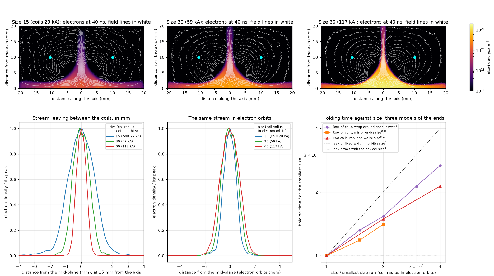
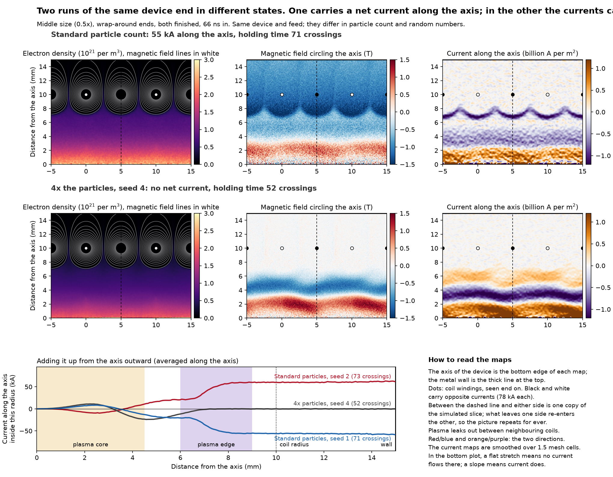
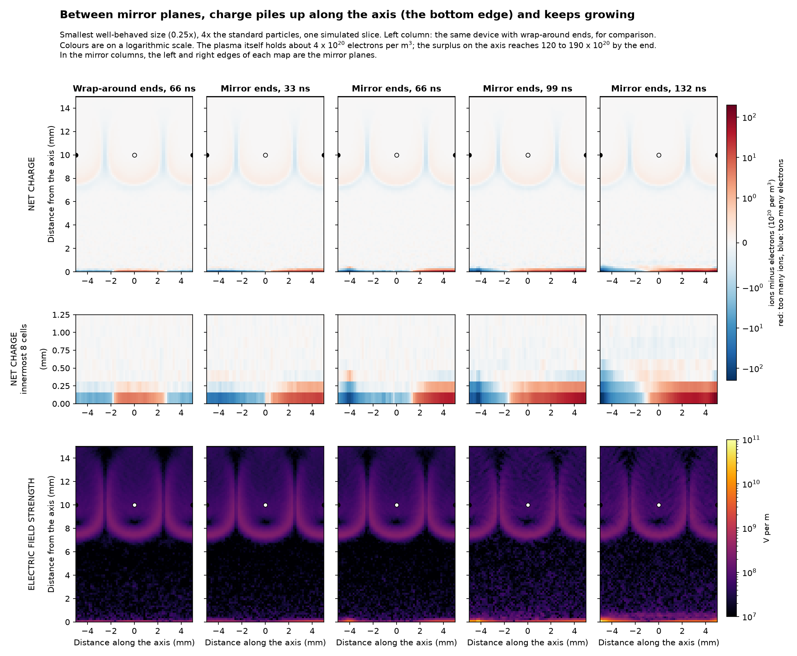
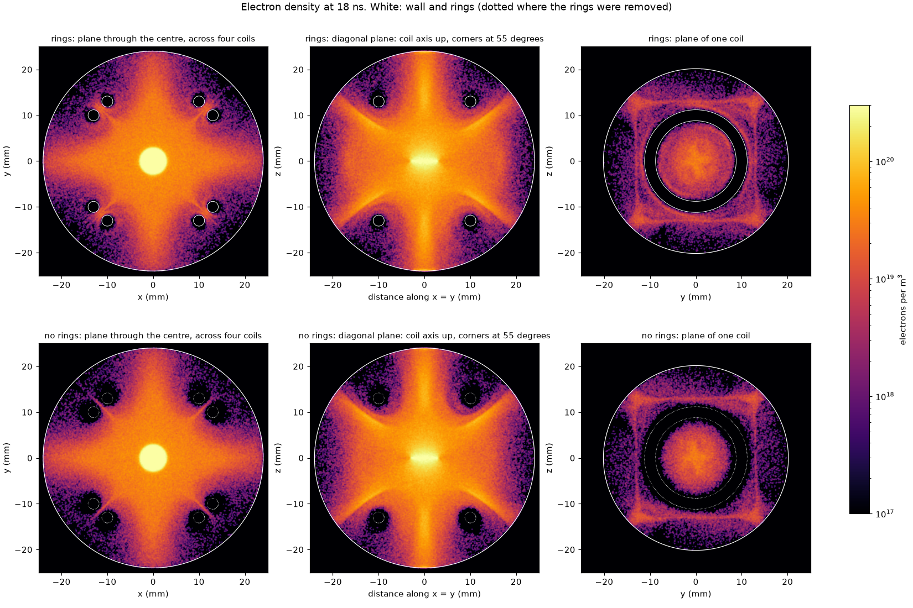
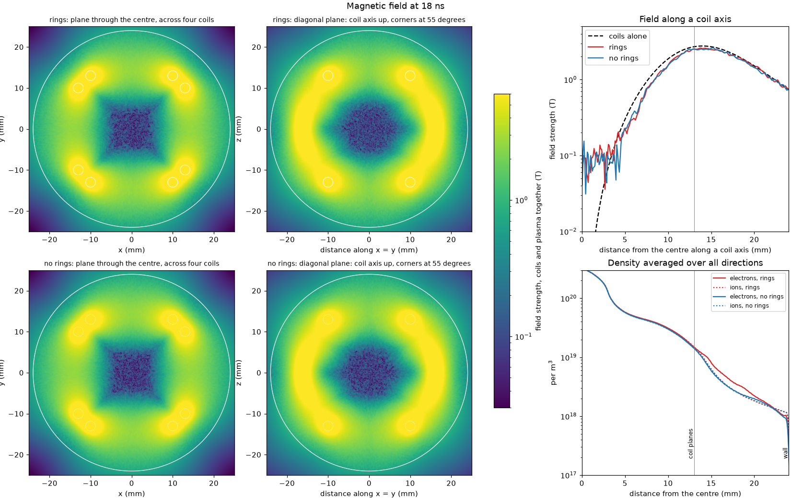
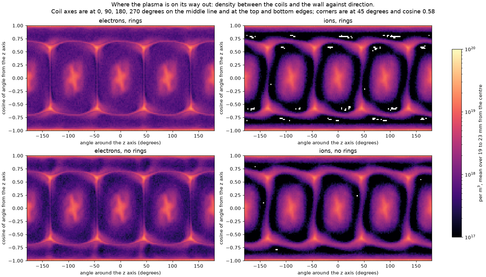
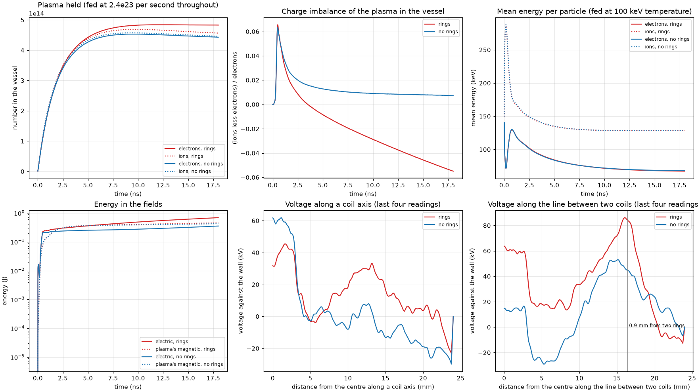
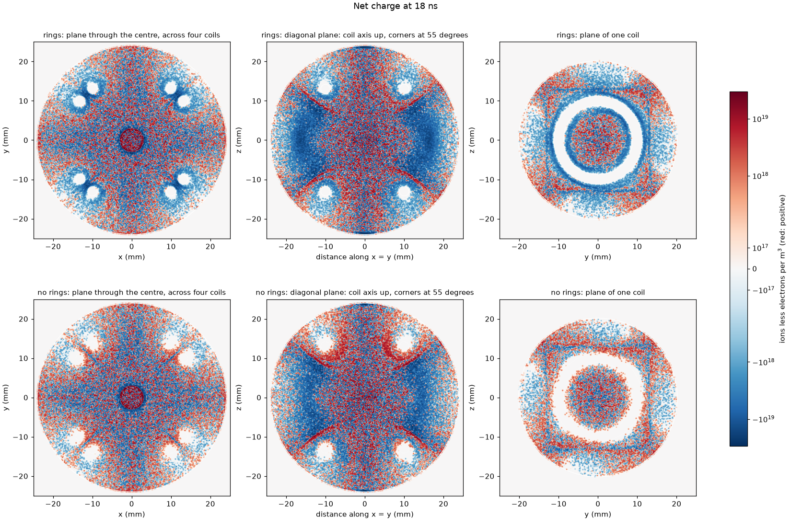
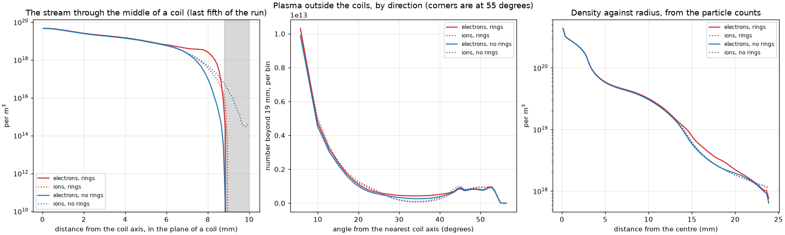

# How well does a magnetic cusp hold a hot, dense plasma? An informal account of the simulations so far

*18 October 2026. Written as an informal paper: what I wanted to know, what the simulations show, what went
wrong, and where I think the performance could be improved. Every number is from a finished run unless marked.
Statements are tagged where it matters: **measured** (from a finished run), **arithmetic** (mine, from measured
numbers), or **reading** (my interpretation). Case names and full tables are in
[cusp-results.md](cusp-results.md).*

## Summary

- A cusp holds plasma in a pocket of weak magnetic field and loses it through holes where field lines lead
  out. The whole question is how wide those holes are, and whether they stay narrow when the machine grows.
- **The boundary between plasma and field is 2 to 3 electron orbits thick in essentially every run.** That is
  the most solid result here, and it is the good half of the hopeful theory.
- **Holding time grows with size, but slower than the hopeful theory needs.** Three models of the device with
  different ends give holding time going as size^0.5 to size^0.7. The theory needs size^1. A leak that grows
  with the machine would give size^0.
- **In the 3D six-coil cage the leak is much worse than in the 2D devices.** The stream through each coil is
  about 6 electron orbits in half-width, not 1, and the plasma is held for about 12 electron crossings.
- **Metal rings around the coils, left floating, raise the number of electrons held by 9%. Most of that is not
  better confinement.** New in this note: inside the cage the gain is 3%. The rest is a cloud of extra
  electrons sitting around the positively charged rings, outside the cage, and that cloud was still growing
  when the run ended.
- **We do not reproduce the one published holding time we tried to match** (Park et al. 2019). Over their own
  time window we get 58 to 63 electron crossings against their 135 to 174. I cannot say which side is right.
- **Holding the rings at a chosen voltage barely helps.** From +50 to +400 kV the plasma inside the cage is 2 to
  5% above no rings, best near +200 kV, which is where a floating ring sits anyway. Other electrode shapes are
  untested.

## 1. What I was curious about

Tokamaks hold plasma on closed magnetic surfaces. A cusp does the opposite: the field is weakest in the
middle and strong all around, so the plasma sits in a magnetic hollow. That shape is stable against the
large-scale wobbles that tokamaks fight, and the plasma can in principle be at a pressure as high as the
field's. The price is that field lines leave the device, and plasma follows them out.

How bad that is depends on the width of the leak:

- If the leak is an **ion orbit** wide, a cusp reactor is hopeless.
- If it is an **electron orbit** wide, it is thousands of times better. Grad conjectured in the 1950s that
  this is what happens once the plasma pressure matches the magnetic pressure: the plasma pushes the field
  out into a sharp skin and leaks only through slits about an electron orbit wide. This is called cusp
  plugging.
- Even then, the reactor case needs the slit to **stay** that narrow as the device gets bigger. Then holding
  time rises in proportion to size.

A 2015 experiment saw signs of the effect and a 2019 simulation (Park et al.) reported it in 2D. I found no
published simulation that measures leak width against device size at fixed pressure with a sustained feed
([prior-work.md](prior-work.md)). That gap is what I set out to fill.

The second question came from the Polywell idea: if the magnetic leak is not good enough by itself, can an
electric field at the holes push the escaping particles back? That is the "plugging" in the electrostatic
sense, and it is where the work is heading now.

## 2. How the experiments work

All runs use WarpX, a particle-in-cell code: it follows sample electrons and ions through electric and
magnetic fields that the particles themselves help make. Nothing about the leak is assumed. The coils' field
is a fixed formula; the plasma's own field is added to it and can cancel it.

Each run feeds plasma in at a steady rate near the centre and lets it leak. Once the amount held stops
changing, **holding time = amount held ÷ feed rate**. Two units make runs comparable:

- **Electron orbit:** the radius of the circle an electron makes in the field at the leak.
- **Electron crossing:** the time a typical electron takes to cross the coil diameter.
- **Size** means the coil radius counted in electron orbits. I change it by raising the coil current in a
  device of fixed physical size, which shrinks the orbit.

Three devices:

| Device | Dimensions | What it is for |
|---|---|---|
| Two coils facing each other, with metal end walls | 2D (symmetric around the axis) | The simplest real cusp: a ring-shaped leak between the coils and a point leak through each coil |
| A row of alternating coils (the "picket fence") | 2D | The published case of Park et al.; ends are either wrap-around or mirrors |
| Six coils on the faces of a cube, inside a spherical wall | 3D | The Polywell cage, with or without metal rings around the coils |

What is artificial, and applies to everything below:

- **Light ions.** Most runs use ions of 57 to 64 electron masses. Deuterium is 3,670.
- **Hot electrons.** Most runs feed at 100 keV. That was chosen so the method's mesh requirement is met, not
  for physics. A fusion plasma is 10 to 20 keV.
- **Small sizes.** Coil radii run from 15 to about 190 electron orbits. A reactor is thousands.
- **3D resolution.** In the 3D runs a cell is 0.1 mm against an electron orbit of 0.4 mm at the coil.

*Figure 1. The two-coil device at three sizes (top). The axis is the bottom edge; cyan dots are the coils seen
end on; white lines are the field. Plasma fills the weak-field pocket and leaves along the axis through each
coil and in a thin sheet between the coils. Bottom left and middle: the sheet between the coils, in mm and in
electron orbits. Bottom right: holding time against size for the three models of section 5.*

## 3. Low pressure: the field only slows the plasma down

The first 3D six-coil runs were at low pressure, where the plasma barely disturbs the field. **Measured:**

| Change | Holding time goes as |
|---|---|
| Coil field | field^0.3 |
| Electron temperature | temperature^−0.5 |
| Ion mass | mass^0.35 |
| Size at fixed field | size^1.3 to 1.45 |

**Reading:** this is plasma leaving at about the speed of sound in the plasma, slowed by the field. Turning
the coils on at all buys a factor of 1.5 to 5 over a 32-fold range of current. A weak dependence on field is
what you would expect when the holes are wide, and it is why low-pressure cusps were abandoned decades ago.
It set the baseline: the interesting regime had to be at high pressure.

## 4. Raising the pressure

In the two-coil device I raised the feed until the plasma pressure passed the magnetic pressure in the gap.
**Measured** (these runs predate the wall correction of section 6, so holding times at the high end are
overstated by 14 to 35% where repeated):

| Plasma pressure ÷ magnetic pressure in the gap | Holding time (ns) | Stream half-width in the gap (mm) |
|---|---|---|
| 0.12 | 8.5 | 0.6 |
| 1.8 | 16.0 | 1.0 |
| 3.7 | 17.9 | 1.8 |
| 8.0 | 23.7 | 3.7 |
| 37 | 19.5 | 7.7 |

Two things came out of this, and they pull in opposite directions:

- **Holding time does rise with pressure**, nearly threefold, up to a pressure ratio of about 8. Then it falls.
- **The leak streams get wider in mm, not narrower.** The naive picture of plugging, that pressure squeezes
  the holes shut, is not what happens. The plasma pushes the field out and the pocket gets bigger, so more
  plasma is held, but the exits widen too.

So there is an optimum fill, and overfilling costs. That is the first handle on performance.

## 5. The main result: how holding time grows with size

**The boundary layer.** Where the plasma meets the field there is a thin current-carrying skin. Across 61
runs at different sizes, fills and numerical settings it is 1.8 to 3.5 electron orbits thick in 60 of them.
This is what the hopeful theory predicts, and it matches Park's 2.1. I consider it solid.

**The scaling.** **Measured,** holding time in electron crossings (two-coil in ns):

| Model | Sizes | Holding time | Goes as size to the power |
|---|---|---|---|
| Row of coils, wrap-around ends | 0.25× to 1× of Park's size | 34, 45, 53, 73, 91 | 0.71 |
| Row of coils, mirror ends | 0.25× to 0.5× | 42, 50, 60 | 0.49 |
| Two coils, real end walls | 15, 30, 60 orbits | 3.99, 5.95, 8.51 ns | 0.55 |

The three models have different flaws (section 6), and they agree. None gives 1 and none gives 0.

**Why it falls short.** In the two-coil device the sheet between the coils narrows in mm as the field goes
up, 1.03, 0.74, 0.54 mm, but the electron orbit shrinks faster. In electron orbits the half-width goes 0.62,
0.88, 1.29 (Figure 1, bottom). So the leak is "about an electron orbit" at every size I have run, but it is
not a fixed number of orbits. It doubles over a fourfold increase in size.

**What that would mean (arithmetic, not a prediction).** Over a 100-fold increase in size, size^1 gives 100
times the holding time and size^0.6 gives 16 times. It costs, but it is not a wall. I would not extrapolate
it: the sizes span a factor of 4, and the two-coil runs were still gaining plasma at the end (5 to 8% per
fifth of the run), so 0.55 is provisional.

**Ion mass.** At one size, with enough particles, holding time rises as ion mass^0.38 (33, 52, 96 crossings
at 16, 64, 256 electron masses) while the electron leak barely widens (mass^0.17). **Reading:** a hole of
roughly fixed size with plasma leaving through it at the ions' speed. If that held up to deuterium, real ions
would be held about 4.6 times longer, counted in electron crossings, than our standard ones (arithmetic:
57^0.38). Three masses at one size; treat it as a hint.

*Figure 2. The row of coils with wrap-around ends, middle size. Left: electron density with field lines; the
plasma leaks up between neighbouring coils. Middle and right: the field circling the axis and the current
along the axis, which are artefacts of the endless-row model discussed in section 6.*

## 6. What did not work, and what fooled me

This section is long because most of the time went here.

**Charge left at the walls.** Until 17 October every 2D run left a little false charge where particles hit
the conducting wall. It pushed electrons back in. With it, our run of Park's case held for 141 crossings
against their published 135, and I reported that as a validation. With the fault fixed the same run gives 85.
The match was made by the bug. Holding times at the smaller sizes fell 30 to 43%, and the first set of size
exponents was withdrawn ([wall-charge.md](wall-charge.md)).

**Too few particles.** At the middle size the standard run gave 71 crossings and the same run with four times
the particles gave 52. Grainy currents make grainy fields, and for a reason I still do not understand, that
makes the run hold more plasma. It is not particles scattering off each other; I proposed that, predicted 46
to 48 at 16 times the particles, and the prediction failed (58). The smallest size does not depend on
particle count. The largest ones still do: 1× gives 91 with 16 times the particles against 104 with 4 times.

**Smoothing is not a cure.** Smoothing the currents lowers the holding time, but one, four and sixteen passes
give 63, 51 and 43 with no levelling off. It shifts the answer by itself. At 2× it blew the run up.

**The endless row carries a current it should not.** With wrap-around ends, some runs settle with a net
current of tens of kiloamps along the axis, comparable to the coil current, in either direction depending on
the random seed (Figure 2). A real device with ends cannot do this. It changes the holding time by tens of
percent.

**Mirror ends pile charge on the axis.** Replacing wrap-around with mirror planes removes the current and
creates a different problem: charge builds up along the axis and keeps growing (Figure 3). It is not a mesh
or noise effect. Where it is large it lowers the holding time by about a tenth.

*Figure 3. Net charge and electric field strength in the smallest size between mirror planes at four times,
beside the same device with wrap-around ends. The surplus on the axis grows throughout.*

**The short box may be the odd one out.** A wrap-around box four coil-periods long behaves like the mirrored
runs, not like the one-period box that Park and I both use: electrons end at 45 keV, not 71, and it holds for
41 crossings, not 34. One run so far; eight more were queued this morning.

**The largest sizes are not clean.** 1× depends on particle count and does not settle. 4× has a holding time
(307) longer than the run itself (300). These are the points that matter most for the scaling and they are
the ones I trust least.

**Park's holding time.** After the wall fix, five things I changed on our side did not close the gap. Over
Park's own window (10 to 28 crossings) we get 58 to 63; their text says 135 and their injection figures imply
174. Their code steps time implicitly and conserves energy exactly but not charge; ours is explicit and
conserves charge exactly but not energy. They re-heat the plasma as they top it up; our electrons cool to 0.6
to 0.7 of the fed energy. Full comparison in [park-vs-warpx.md](park-vs-warpx.md).

**The implicit methods.** Today I tried WarpX's two implicit schemes on the Park-matched case. Both failed on
the GPU: the semi-implicit solver has diverged four times, first at 11% of the run, and the fully implicit one
diverged at 26%.
I have not tuned either. So I have no cross-method comparison, and the question of whether the method
explains the gap is still open.

**100 keV.** I argued that temperature drops out if you count in orbits and crossings. That was too strong.
At pressure balance the plasma's screening length is 0.6 of an electron orbit at 100 keV and 0.1 at Park's
2.77 keV (arithmetic). Our leak is a few screening lengths across; theirs is 10 to 20. Our plasma can hold
far more charge imbalance on the scale of the leak. Measured, colder runs hold a third longer late in the run.

**Reading of all this:** the 2D endless-row model, which is the published standard, is shakier than the
literature suggests. In hindsight I should have moved to the two-coil device with real walls sooner. It had
none of these artefacts.

## 7. The 3D cage at high pressure, with and without rings

This is the device the plugging question is really about. Two finished runs at full resolution (512 cells
across 5 cm), same coils (78 kA), same feed, 18 ns: one with a metal ring around each coil, connected to
nothing, and one with the rings removed. A third run with rings and the wall correction gives the same
numbers as the first (2.02 against 2.01 ns), so the wall fault does not matter in 3D.

*Figure 4. Electron density at 18 ns in three cuts. Top: with rings. Bottom: rings removed (dotted outlines
show where they were). The bright ball in the middle is where plasma is fed in. Nothing is averaged over the
device's symmetries.*

*Figure 5. Strength of the whole field (coils and plasma) in two cuts; along a coil axis against the coils
alone; and the density averaged over all directions.*

**What the plasma does to the field (measured).** The middle of the cage is a pocket of weak field, under 0.5 T against
2.8 T at the coils, about 14 mm across (Figure 5). Along a coil axis in the run without rings the field is 10 to
33% below the coils' own between 5 mm and the coil plane. Close to the centre the plasma cancels more, but that number is noisy: the three runs give a cut of
48%, 65% and 82% at about 0.45 of the coil radius. **Reading:** this is a plasma that has pushed the field
back noticeably. It has not formed the sharp skin seen in 2D.

**Where it leaks (measured).** Mostly through the middle of each coil. About half of the plasma found
outside the coils is in those six streams and about 12% is at the corners. The sky map (Figure 6) shows all
three kinds of exit: six broad spots through the coils, eight bright points at the corners, and thin lines
joining them along the edges between coils.

*Figure 6. Density between the coils and the wall against direction. Electrons left, ions right; rings top,
no rings bottom.*

**How wide and how fast (measured).** The stream through a coil has a half-width of 2.3 mm. The electron
orbit there is 0.39 mm. That is 6 electron orbits, against about 1 in the 2D devices. The plasma is held for
2.0 ns, which is about 12 electron crossings (arithmetic). The two-coil device at a comparable size holds
for 24 to 36. So the cage is two to three times leakier, and its leak is not electron-orbit sized. The cells
are a quarter of an orbit, so I would not put weight on the exact width.

**What the rings do.** This is the part I had reported as "floating rings help by 10%". The figures show it
needs restating.

*Figure 7. Top: plasma held, its charge imbalance, and mean energies. Bottom: energy in the fields, and the
voltage along two lines from the centre to the wall.*

*Figure 8. Net charge at 18 ns. Blue is a surplus of electrons. With rings (top) each ring sits in a cloud of
extra electrons.*

| At 18 ns (measured) | Rings | No rings | Difference |
|---|---|---|---|
| Electrons in the vessel | 4.83 × 10^14 | 4.43 × 10^14 | +9% |
| Ions in the vessel | 4.56 × 10^14 | 4.46 × 10^14 | +2% |
| Electrons within 13 mm of the centre (the distance of the coil planes) | 3.14 × 10^14 | 3.04 × 10^14 | +3% |
| Ions within 13 mm | 3.13 × 10^14 | 3.04 × 10^14 | +3% |
| Electrons beyond 13 mm | 1.69 × 10^14 | 1.38 × 10^14 | +22% |
| Ions beyond 13 mm | 1.43 × 10^14 | 1.42 × 10^14 | +1% |
| Ions less electrons, as a share of electrons | −5.5%, falling steadily | +0.7%, steady | |
| Energy in the electric field (J) | 0.69, rising | 0.35 | |
| Mean electron / ion energy (keV) | 67 / 129 | 68 / 129 | none |

- **Inside the cage the rings add 3%**, to electrons and ions alike.
- **The rest of the 9% is electrons outside the cage.** The rings collect more ions than electrons and charge
  positive. Electrons then gather around them (Figures 4 and 8). They are held by the rings' charge, not by
  the cusp.
- **It is not a steady state.** The plasma with rings was 2.5% negative at 9 ns, 4.1% at 13.5 ns and 5.5% at
  18 ns, and the electric field energy was still climbing. I do not know where it settles.
- The rings do not change the plasma's energy or the width of the stream through the coil (2.31 against
  2.27 mm).
- **A correction.** I told you the rings charged themselves to +140 to +170 kV in this pair. That figure came
  from a small coarse trial, not from these runs. Here, the one probe line that passes 0.9 mm from two rings
  reads about +85 kV there, against +50 kV at the same place without rings. Those line voltages are rough: two
  lines that meet at the centre disagree there by 30 to 47 kV.

*Figure 9. Left: the stream through the middle of a coil; the grey band is where the ring is. Middle: plasma
outside the coils against angle from the nearest coil axis. Right: density against radius.*

**Reading:** this is weak evidence for electric plugging. A floating ring is a poor test: it takes whatever
voltage the losses give it and it sits beside the leak, not across it. The honest summary is that a charged
ring holds electrons near itself, and has a small effect on the plasma inside. Whether a ring at a chosen,
higher voltage does better is exactly what the runs submitted today ask.

### Rings held at set voltages (added 09:40 UTC, 18 October)

Four runs with the rings joined to the wall by thin rods and held at a chosen voltage, by adding the vacuum
field of that voltage to the plasma's own (campaign `rv2`; method in
[ring-voltage-design.md](ring-voltage-design.md)). Same coils and feed as the pair above. All finished.
Averages over the last fifth of each run. "None" and "floating" are the earlier pair, from a different deck
with the same physics; the matching controls in the new deck are still running.

| Rings | Plasma inside the cage ÷ feed (ns) | Against no rings | All electrons in the vessel ÷ feed (ns) | Ring voltage read back (kV) |
|---|---|---|---|---|
| None | 1.283 | | 1.84 | |
| Floating | 1.323 | +3% | 2.01 | not measured in that run |
| +50 kV | 1.305 | +2% | 1.85 | 42 to 49 |
| +100 kV | 1.327 | +3% | 1.91 | 100 to 106 |
| +200 kV | 1.347 | +5% | 2.02 | 198 to 205 |
| +400 kV | 1.312 | +2% | 2.20 | 390 to 399 |

| Rings | Ions onto the rings (MW) | Electrons onto rings and rods (MW) | Electrons less ions onto rings and rods (A, arithmetic) |
|---|---|---|---|
| +50 kV | 240 | 4 | ions dominate |
| +100 kV | 170 | 8 | ions dominate |
| +200 kV | 80 | 29 | about 20 |
| +400 kV | 15 | 157 | about 780 |

- **Measured:** inside the cage the gain peaks at +5% near 200 kV and is back to +2% at 400 kV. The total in
  the vessel keeps rising with voltage only because more electrons gather at the rings: at 400 kV there are 15%
  more electrons than ions in the vessel.
- **Measured:** in the runs still going, floating rings sit at 190 to 200 kV, and at 200 kV set the electron
  and ion currents onto the metal nearly cancel. So 200 kV is the voltage the plasma chooses.
- **Reading:** below that voltage the rings are a sink for ions; above it they draw electrons, about 780 A at
  400 kV, which a supply would pay for at up to that voltage. Ring voltage is a weak knob and its best setting
  is about where a floating ring sits anyway. One run per voltage, so differences of 2 to 5% have no error bar
  yet.

## 8. Ways the performance might be improved

In rough order of how much evidence there is. Only the first two have any measurement behind them here.

1. **Do not overfill.** Holding time peaked at a pressure ratio near 8 in the two-coil device and fell beyond
   it. In the row of coils at the smallest size, fill made no difference. There is an operating point to find,
   and it is cheap to map.
2. **Heavier ions.** Holding time rose as ion mass^0.38 with little widening of the electron leak. Real ions
   are 57 times heavier than ours. This is "free" in the sense that a real device has it already, but it means
   our light-ion runs understate the holding time in electron crossings.
3. **Electrodes at a chosen voltage.** The literature reports density or decay time up by a factor of 2 to 3
   from electric plugging in low-pressure laboratory cusps
   ([electrostatic-plugging-prior-work.md](electrostatic-plugging-prior-work.md)). I found no kinetic
   simulation of it near pressure balance. The known cost is electron current to the positive electrode, paid
   for at the full voltage, so holding time alone is the wrong score: power to the rings has to be counted. The
   new runs measure both.
4. **Put the electrode across the leak, not beside it.** Section 7 says most of the loss goes through the
   middle of each coil, where a ring around the coil has least reach. An electrode on the coil axis outside the
   cage, or a repelling end plate, faces the stream directly. In the earliest electron-only cage, making the
   outer wall more negative (−300 V to −1 kV) cut the electron loss to the wall from 0.28 A to 0.07 A. Untested
   with a real plasma at high pressure.
5. **Close the big holes magnetically.** In 3D the face streams are 6 orbits wide while the 2D sheet between
   coils is about 1. That points at the geometry of the hole through a coil. Smaller coil openings, coils
   closer together, or more faces (so each hole is a smaller share of the surface) are all untested here.
6. **Fewer ends.** In the row of coils, mirror ends and long boxes held 10 to 28% more plasma per period than
   the short wrap-around box. A long device with few ends loses less per unit of plasma. One comparison,
   tangled with the artefacts of section 6.
7. **Where the plasma is fed.** Plasma fired in from guns outside the cage was held 45 to 65% as long as
   plasma born at the centre. Feeding matters by a factor of about 2.

## 9. What I believe, and how firmly

| Statement | Standing |
|---|---|
| The plasma–field boundary is 2 to 3 electron orbits thick | Solid |
| The leak in the 2D devices is about one electron orbit in half-width at every size run | Solid over a factor of 4 in size |
| Holding time grows as size^0.5 to 0.7, not size^1 | Probable. Three models agree; largest sizes not clean; two-coil runs not fully settled |
| The 3D cage leaks mainly through the coils, in streams about 6 orbits wide | Measured in one configuration at one resolution |
| Floating rings improve confinement by 10% | Restated: 3% inside the cage; the rest is electrons parked at the rings, not settled |
| Our code reproduces Park et al. 2019 | Boundary thickness yes. Holding time no, by a factor of 2.2 to 3 |
| Rings around the coils at a set voltage plug the leaks | No, at this pressure: +2 to +5% inside the cage from +50 to +400 kV, best near the floating voltage. Matching controls still running |
| Any of this extrapolates to reactor size, real ion mass or 10 keV | Unknown |

## 10. What is next

1. Rings grounded, floating, and held at +50, +100, +200 and +400 kV, against no rings and against a control
   for the extra metal. Score: holding time inside the cage, and power landing on the rings.
2. A second seed of the ring pair, to put an error bar on a 3% effect.
3. If voltage helps: the same at half and double size. Whether an electric plug improves the size scaling is
   the number that decides if this direction is worth more.
4. The two-coil device with real walls as the main size-scan model, pushed to larger sizes.
5. An electrode facing the coil stream (item 4 of section 8).

## Method notes

- Figures 4 to 9 are drawn by `warpx/cusp/plot_ring_pair.py` from cuts made by `warpx/cusp/cage_cuts.py`;
  Figure 1 by `warpx/cusp/plot_two_coil_sizes.py`; Figures 2 and 3 by `warpx/cusp/plot_field_maps.py`.
- The ring pair is `h_78k_f2.4e23` (rings) and `hr_78k_f2.4e23` (no rings). Both use the default current
  deposition. `hw_78k_f2.4e23` is the ring run with the wall correction.
- The 3D snapshots hold magnetic field and charge density only. No electric field or voltage map was saved,
  so voltages come from three probe lines.
- Every result uses WarpX patches that nobody but me has reviewed ([warpx-patches.md](warpx-patches.md)).
