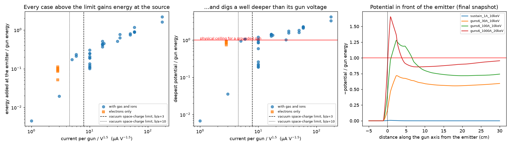

# From-scratch audit and research directions (2026-10-15)

This document re-derives what the six-coil runs show from the raw histories and snapshots, without
relying on the earlier write-ups, and then ranks non-tokamak directions where large GPU compute
decides an open question. Where it contradicts `six-coil-design.md`, `multi-gun-design.md` or
`ion-pic-design.md`, this document is the current reading.

The scripts are in `analysis/fresh/`; they read the fetched run tree
(`/home/ubuntu/cusp/space-charge-checks`) and only accept cases whose `DONE` file is `complete`.

## Part 1: audit

### What was checked and passed

| check | method | result |
|---|---|---|
| Poisson solve | 7-point Laplacian of the stored potential against stored electron + ion charge, r < 0.35 m, three cases | residual 1e-12 of the source term |
| Vacuum coil field | independent Biot–Savart sum over six discretized loops | face-cusp maximum 17.62 mT at r = 0.66 m; the run records 17.61 mT at r = 0.65 m |
| Charge bookkeeping | injected − lost − alive, and grid charge against particle charge | 1e-14 C or better |
| Particle energy at low current | per-electron KE − eφ in the final 1 A snapshot | median 10 011 eV for a 10 000 eV gun with the emitter at −45 V |
| Ionization rate | 1/(n_gas σ v) with the Lotz cross-section, by hand | 188 µs at 1e-3 Pa; runs report 185 µs |

The field solver, magnetic field, charge conservation and pusher are not the problem.

### What failed: the gun is a constant-kinetic-energy source

`GunSource` places every electron at the emitter with kinetic energy equal to `--energy-ev`,
whatever the potential at that point is. The emitter sits on the front face of a grounded barrel,
but the beam's own charge pulls the interpolated potential there below zero. An electron injected
with kinetic energy E where the potential is φ_src < 0 has total energy E + e|φ_src|, and it
reaches the grounded walls with that much kinetic energy. The source therefore adds e|φ_src| per
electron, which no gun with a grounded anode can do: a real beam would arrive at that point with
E − e|φ_src| and would be turned back wherever the potential falls below −E/e.

Evidence, final quarter of each run (`audit_energy.py`):

| case | gun energy | φ at emitter | mean energy of lost electrons | deepest potential |
|---|---|---|---|---|
| 1 gun, 1 A | 10 keV | −38 V | 10.03 keV | −67 V |
| 1 gun, 3 A | 10 keV | −210 V | 10.19 keV | −368 V |
| 1 gun, 10 A (long) | 10 keV | −1.98 kV | 11.87 keV | −6.2 kV |
| 1 gun, 30 A | 10 keV | −5.19 kV | 14.67 keV | −12.0 kV |
| 6 guns, 30 A | 10 keV | −1.66 kV | 11.20 keV | −9.4 kV |
| 6 guns, 100 A | 10 keV | −4.34 kV | 12.51 keV | −14.1 kV |
| 6 guns, 1000 A | 20 keV | −17.7 kV | 34.76 keV | −42.9 kV |
| 6 guns, 3000 A, 49 nodes | 20 keV | −43.9 kV | 55.31 keV | −84.3 kV |

The lost-electron energy tracks E + e|φ_src| to within 0–17%, so the source accounts for the
energy excess; grid heating is not needed to explain it. The remaining difference has the sign of
electrons giving energy to ions and to the time-varying field.

The onset is where paper physics puts it. The space-charge limiting current of a beam of radius a
in a grounded enclosure of radius b is I = 17 kA (γ^(2/3) − 1)^(3/2) / (1 + 2 ln(b/a)), which is
4.5–7.9 A at 10 keV and 13–22 A at 20 keV for b/a between 10 and 3 (`paper.py`). Above that a
real beam forms a virtual cathode and the excess current returns to the gun. Of the 51 distinct
complete cases that record the emitter potential, 30 exceed the b/a = 3 limit; 21 of those 30 have
a potential minimum deeper than the gun voltage, which a grounded gun cannot produce. The structure
that does it is one to two cells wide (right panel), so it is also unresolved.

### Consequences for earlier claims

| earlier claim | status |
|---|---|
| Six guns reach −10 kV (10 keV) and −19 to −23 kV (20 keV) at the centre | Not established. Those electrons carry 1.1–1.7× the gun energy. A real gun cannot push the centre to the full gun voltage, because the beam would stagnate there. |
| Per-gun choke near 1e-4 A/V^1.5; 3000 A chokes | Not established. The physical limit is about 5e-6 A/V^1.5 per gun without neutralization, 20× lower, and it shows up as reflected current, not as a deeper well. |
| Gun energy matters more than current | Direction is right on paper (limit ∝ V^1.5, well ≤ V), but the runs cannot quantify it. |
| At 10–30 A the well survives gas ions | Not established; see below. |
| 10 A is numerically bistable | Reinterpreted. 10 A at 10 keV sits on the limiting current, where a beam has a transmitted state and a virtual-cathode state with hysteresis. The split is probably that physics, driven by an unphysical source. |
| Stronger coils barely help; electrons stay 0.4–4.8 transits | Only measured in contaminated runs. The clean runs give 98 ns, about 6 transits, at one field strength. No clean B scan exists in the fetched data. |
| Mesh sensitivity at 1000–3000 A | Real, and expected: the potential structure at the emitter is one cell wide. |
| Beta 1e-5 to 4e-3, far from cusp plugging | Stands. It follows from density and field alone, and the paper ceiling below is lower still. |

### What the clean runs say

Only the single-gun 1 A and 3 A runs at 10 keV keep the source error under 2%. In both, ions made
from 1e-3 Pa of H2 cancel the electron charge completely: the centre potential goes from −1.6 kV
to −1 V (1 A) and from −5.0 kV to −73 V (3 A) over 320 µs, with a measured ion fraction of 1.00.

That is the first-principles expectation at any current. The box, barrels and casings are all at
0 V, so an ion born at rest where the potential is negative cannot reach any surface in a steady
well. Ions accumulate at the rate n_gas σ v per electron until the well is gone; the time is
1/(n_gas σ v) = 0.19 ms at 1e-3 Pa and 0.19 s at 1e-6 Pa, independent of current. A well that
persists for several of those times, as the 10–1000 A runs show, needs a steady ion loss. The only
candidates in this model are the source artefact and cycle-to-cycle changes of the operator-split
field, neither of which is physics. The 5/10/20 µs splitting cases disagreeing with each other
points the same way.

### Paper physics for this device

- **Well depth** is at most the gun voltage, reached at about the limiting current: 5–8 A per gun
  at 10 keV, 140–240 A per gun at 100 keV. More current is reflected.
- **Electron excess** for a well of depth V over radius a is n = 6 ε0 V / (e a²): 3.7e13 m⁻³ for
  10 kV over 0.3 m. An electron-only device cannot exceed this, whatever the feed.
- **Fusion-relevant density** (1e19–1e20 m⁻³) therefore means a plasma neutral to one part in
  1e6. Its Debye length is tens of micrometres, and its pressure changes the magnetic field. The
  present electrostatic, vacuum-field model on a 1 cm mesh cannot represent it.
- **Electron loss** in the clean runs corresponds to an effective hole area of 0.37 m², or 14
  holes of radius 9 cm, when the electron gyroradius at the face cusp is 1.9 cm. The device is
  weakly magnetized: inside r = 0.3 m the field is below 4 mT and the gyroradius exceeds 8 cm.

### What is needed before more electrostatic runs

1. Make the source conserve energy: inject with kinetic energy E + eφ(x) and return the packet to
   the barrel when that is not positive, or recess the emitter inside a hollow grounded barrel so
   the virtual cathode forms and reflects current on the mesh. This changes injection code, which
   `AGENTS.md` gates on a reviewed design.
2. Record `injected_total_energy` and reflected current so the energy balance closes by
   construction, and fail a run whose residual exceeds a few percent.
3. Equal-aspect cells and at least four cells across the barrel radius.

## Part 2: where compute decides something

### What Rider's argument does and does not forbid

Rider (Phys. Plasmas 2, 1853 (1995); 4, 1039 (1997)) and Nevins (Phys. Plasmas 2, 3804 (1995))
show that holding a plasma far from thermal equilibrium in steady state costs more recirculating
power than the fusion power it yields, because Coulomb scattering outpaces fusion. The argument
assumes steady state, a roughly uniform and isotropic collision environment, energy removed and
re-injected by an external system at ordinary efficiency, and no internal mechanism that moves
energy between particle classes selectively. It does not forbid a thermal D-T plasma in an unusual
confinement geometry; there the question is confinement, not Rider. Compute cannot beat the
thermodynamics. It can settle whether a specific loophole works, or measure a confinement law
nobody could afford to simulate.

### Ranked directions

| rank | direction | assumption it attacks | the open question | why compute decides it | cost per run | reuse of our code |
|---|---|---|---|---|---|---|
| 1 | High-beta cusp leak law | none; this is confinement of a thermal or electron-driven plasma | Is the loss aperture of a β ≈ 1 cusp one electron gyroradius (Grad's conjecture), the hybrid gyroradius, or the ion gyroradius, and how does it scale with R/ρe and mass ratio in 3D? | Needs fully kinetic electromagnetic PIC resolving ρe in 3D. The only published first-principles run found is a 2D picket fence with about 2e8 particles (Park et al., Front. Astron. Space Sci. 6, 74 (2019)). | 3D, R = 200 ρe: about 5e8 cells, 5e10 particles, of order 1e4 GPU-hours | geometry, diagnostics, campaign tooling; not the solver |
| 2 | Oscillating thermal ion cloud (POPS) in an electron-rich trap | far-from-equilibrium ions: the oscillating cloud is an exact thermal-equilibrium solution, so collisions cost nothing | How much compression survives self-consistent 3D electron neutralization and virtual-cathode stability? Evstatiev et al. (Phys. Plasmas 14, 042701 (2007)) found limits in reduced models. | Device is centimetre scale and non-neutral, so the Debye length is the device size and full physics fits one GPU. Thousands of runs make it a search over injection, RF drive and geometry. | about 10 GPU-hours | high: electrostatic PIC with guns and ions; needs ions and electrons advanced together and RF electrodes |
| 3 | Wave-mediated energy channeling for p-11B or D-3He | "no selective internal energy transfer": waves move fusion-product energy to fuel ions before electrons take it | Do the required waves exist and act as assumed in a real mirror or field-reversed geometry? Power-balance models (Ochs et al., Phys. Rev. E 106, 055215 (2022)) assume they do. | Self-consistent wave–particle interaction with a fusion-product source in 3D; hybrid PIC (kinetic ions, fluid electrons) at ion-cyclotron scales. | 1e3–1e5 GPU-hours | low |
| 4 | Collisional-timescale kinetics of electrostatic and cusp traps | uniform, isotropic collision model | Redo Rider/Nevins with a self-consistent well and real orbits: is there a well shape and feed with Q > 1, as the bounce-averaged 1D result of Chacón et al. (Phys. Plasmas 7, 4547 (2000)) suggests? | Multi-dimensional bounce-averaged Fokker–Planck, moderate compute. It is the gate for any electrostatic concept, and it replaces the power-balance map paused earlier. | CPU to modest GPU | none; new solver |
| 5 | Kinetic sheared-flow Z-pinch at reactor scale | none; confinement and stability | Does shear stabilization hold as ion gyroradius over pinch radius shrinks? | 3D fully kinetic, dense, collisional, electromagnetic. | 1e4–1e6 GPU-hours | none |

Deliberately left out: Helion-style pulsed field-reversed compression and beam-driven
field-reversed plasmas are well funded and already simulated at scale by their developers;
stellarator optimization is the highest-value compute problem in fusion but is neither
underexplored nor a Rider question; colliding-beam and beam-target schemes fail on scattering
versus fusion cross-sections regardless of compute.

### The pass/fail bar for direction 1

For D-T at 1e20 m⁻³ with 50 keV electrons, fusion yields 5.6 MW/m³, so break-even on electron
losses alone needs an electron lifetime of 0.14 s, about 9e6 transits of a 1 m device. Written as
14 point-cusp holes, that is a hole radius of:

| B | R | allowed hole radius | electron gyroradius | hybrid gyroradius | ion gyroradius |
|---|---|---|---|---|---|
| 5 T | 1 m | 0.15 mm | 0.15 mm | 1.3 mm | 10 mm |
| 10 T | 1 m | 0.15 mm | 0.077 mm | 0.63 mm | 5.1 mm |
| 10 T | 2 m | 0.42 mm | 0.077 mm | 0.63 mm | 5.1 mm |

A metre-scale 5–10 T machine works only if the aperture is one to two electron gyroradii. A
hybrid-gyroradius aperture needs roughly 2–3 m and 10 T or more; an ion-gyroradius aperture never
works. So the quantity to measure is the aperture in electron gyroradii as a function of β, R/ρe
and mass ratio. EMC2 quotes 0.5 s for 100 keV electrons at 7 T and 1 m on Grad's formula, the
same order as this bar. The present runs sit at a 9 cm aperture for a 1.9 cm gyroradius at β near
1e-5, which says nothing about the high-β law.

### Recommendation

1. Direction 1 first, on an existing multi-GPU electromagnetic PIC code, not ours. WarpX has
   electromagnetic and implicit energy-conserving solvers, embedded conductors, external fields,
   binary Coulomb collisions and D-T, D-D, D-3He and p-11B reactions. Start with the 2D picket
   fence to reproduce the published electron-scale layer, measure aperture against β and mass
   ratio, then run the 3D six-coil case at R = 50–200 ρe.
2. Direction 4 in parallel on CPU, as the power balance that says which leak law is good enough.
3. Direction 2 as a contained side project in our code once the gun is fixed, because it is the
   one concept built to evade Rider and it is cheap enough to search exhaustively.

Citations are from memory except the three confirmed by search on 2026-10-15 (Park 2019,
Evstatiev 2007, Ochs 2022); check the others before quoting them externally.
