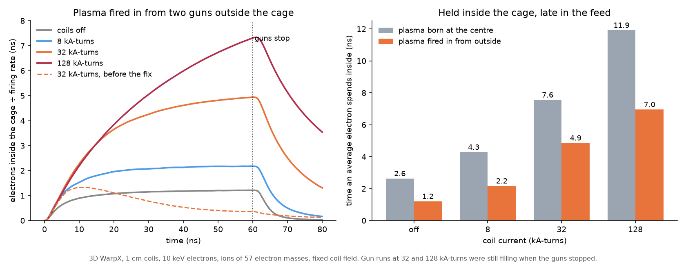

# Plasma fired into the six-coil cusp from guns outside it

Status: first results, 2026-10-16. Every number here uses `flux-paired.patch`, which has not been reviewed
(`flux-injection-charge.md`). Gun runs made before it (`jet1`, `jet2`) are not usable.

## What is run

Deck `inputs_3d_cusp_jets`, campaign `jet3`. Nothing starts inside. Two guns sit on the z axis at 1.9 coil radii
from the centre, outside the coil planes at 1.3. Each mouth is a disc of radius 0.3 coil radii that sends out
neutral plasma toward the centre, along the coil field there (angle 0 degrees; the field at the coil opening is
1.52 times that at the mouth). Coil radius 1 cm, 10 keV electrons, 1 keV ions of 57 electron masses, 1e22
electrons and ions per second from the two guns together, fixed coil field, plasma fields from Maxwell's
equations, 128 cells across a 5 cm box. The guns fire for 60 ns and the run goes on to 80 ns.

"Held" is the number of electrons within 1.3 coil radii of the centre late in the firing, over the firing rate:
the time an average fired electron spends inside. The centre-fed column is the same count for plasma born on a
disc at the centre (`fed3`).

## Results

| Case | Coils (kA-turns) | Held (ns) | Left 20 ns after the guns stop | Loss time after stop (ns) | Centre-fed held (ns) |
|---|---|---|---|---|---|
| `p_off` | 0 | 1.21 | 2% | 7.6 | 2.63 |
| `p_8k` | 8 | 2.17 | 8% | 9.1 | 4.29 |
| `p_32k` | 32 | 4.86 | 26% | 15.4 | 7.56 |
| `p_128k` | 128 | 6.96 | 48% | 27.0 | 11.92 |

- Plasma fired from outside gets in and is held 45 to 65% as long as plasma born at the centre.
- At 32 and 128 kA-turns the amount inside was still rising when the guns stopped, so those two are lower bounds.
- A second seed at 32 kA-turns gives 4.85 ns against 4.86. With 192 cells across the box instead of 128
  (`p_32k_n192`) it is 5.09 ns, 5% more, with 28% left against 26%.
- The streams leaving through the coil openings are 2.3 to 2.8 mm in half-width with the coils on, while the
  electron orbit there goes from 1.2 mm to 0.08 mm. As in the centre-fed runs, the width does not follow the orbit.

Other settings at 32 kA-turns unless said:

| Case | Change | Held (ns) | Left 20 ns after stop |
|---|---|---|---|
| `p_32k_v1e7` | directed speed 1e7 m/s toward the centre | 3.57 | 5% |
| `p_32k_v2e7` | directed speed 2e7 m/s | 1.80 | 2% |
| `p_128k_v1e7` | 128 kA-turns, 1e7 m/s | 7.60 | 21% |
| `p_off_v1e7` | coils off, 1e7 m/s | 1.62 | 0.2% |
| `p_32k_te1e3` | 1 keV electrons | 11.89, still rising | 52% |
| `p_off_te1e3` | 1 keV electrons, coils off | 2.24 | 4% |
| `p_32k_te1e3_v1e7` | 1 keV electrons, 1e7 m/s | 5.76 | 7% |
| `p_32k_f1e21` | a tenth of the firing rate | 4.38 | 28% |
| `p_32k_f1e23` | ten times the firing rate | 3.27 | 23% |

- A directed speed makes the jet pass straight through and out of the far opening: more is inside while the guns
  fire at 128 kA-turns, but less stays once they stop, at every field.
- Colder plasma is held longer, as in the centre-fed runs (time goes with size over sound speed).
- Ten times the firing rate holds a third less per particle.

## Second set: longer firing, gun position and size, heavier ions, temperature, firing rate

At 32 kA-turns unless said. "Left" is the share of what was inside when the guns stopped that is still inside at
the end of the run, which is 20 ns later unless a longer time is given.

| Case | Change | Held (ns) | Left | Loss time after stop (ns) |
|---|---|---|---|---|
| `q_32k_long` | guns fire for 150 ns | 4.87, level | 6% after 50 ns | 23.6 |
| `q_128k_long` | 128 kA-turns, fire for 180 ns | 9.63, nearly level | 20% after 60 ns | 45.7 |
| `q_32k_near` | mouths at 1.6 coil radii, not 1.9 | 7.23 | 22% | 14.9 |
| `q_32k_far` | mouths at 2.2 coil radii | 2.37 | 29% | 15.2 |
| `q_32k_narrow` | mouth radius 0.15, not 0.3 | 3.49 | 21% | 13.3 |
| `q_32k_wide` | mouth radius 0.6 | 3.61 | 30% | 17.2 |
| `q_32k_one_gun` | only one gun fires | 4.51 | 26% | 15.6 |
| `q_32k_m229` | ions four times heavier, fire for 180 ns | 7.81, level | 11% after 60 ns | 35.3 |
| `q_off_m229` | the same, coils off | 2.39 | 2% after 40 ns | 16.0 |
| `q_32k_te2500` | 2.5 keV electrons, fire for 120 ns | 10.37 | 23% after 40 ns | 29.8 |
| `q_32k_te40k` | 40 keV electrons | 2.13 | 8% | 10.0 |
| `q_32k_f1e24` | 100 times the firing rate | 4.14 | 10% | 8.5 |
| `q_128k_f1e23` | 128 kA-turns, 10 times the rate, fire for 120 ns | 9.10 | 26% after 40 ns | 32.9 |
| `q_128k_f1e24` | 128 kA-turns, 100 times the rate | 6.90 | 2% after 40 ns | 9.6 |

(`q_32k_one_gun`: the reducer divides by the rate of both guns and reports 2.26; 4.51 is per electron fired.)

- The held time settles: firing two and a half times longer at 32 kA-turns gives the same 4.9 ns. At 128
  kA-turns the settled value is 9.6 ns, not the 7.0 read at 60 ns.
- Where the mouths are matters most. At 1.6 coil radii the held time equals that of plasma born at the centre
  (7.6 ns); at 2.2 it is a third of that.
- One gun holds as much per electron fired as two (4.5 against 4.9 ns), so the two jets do not need each other.
- Held time goes as about mass^0.34 and temperature^-0.57, close to the centre-fed runs (0.35 and -0.5): it tracks
  size over sound speed. Against the coils-off runs at the same mass the gain from the field is 4.0 at 57
  electron masses and 3.3 at 229.
- A hundred times the firing rate costs 15% of the held time at 32 kA-turns and 28% at 128.
- Still running: 512 kA-turns and ions of 918 electron masses.

## Third set: mouths closer to the coils

Mouths at 1.6 coil radii unless said (the coil planes are at 1.3). 60 ns of firing.

| Case | Coils (kA-turns) | Held (ns) | Left 20 ns after stop | Mouths at 1.9, for comparison |
|---|---|---|---|---|
| `r_off_near` | 0 | 1.78 | 1% | 1.21 |
| `r_8k_near` | 8 | 3.53 | 5% | 2.17 |
| `q_32k_near` | 32 | 7.23 | 22% | 4.86 |
| `r_32k_near_f1e24` | 32, 100 times the firing rate | 5.95 | 12% | 4.14 |
| `r_32k_at_1.4` | 32, mouths at 1.4 | 8.46 | 22% | |

- With the mouths at 1.4 coil radii, just outside the coil planes, plasma fired in is held longer (8.5 ns) than
  plasma born on a disc at the centre (7.6 ns).
- A second 192-cell repeat with the mouths at 1.9 (`q_32k_n192`) gives 5.08 ns, the same as the first (5.09).
- Still running: 128 kA-turns, a long firing, heavier ions and a 192-cell repeat with the mouths at 1.6.

## Scans completed since (2026-10-16, 15:17 UTC)

Mouths at 1.9 coil radii, firing long enough to settle:

| Coils (kA-turns) | 0 | 8 | 32 | 128 | 512 |
|---|---|---|---|---|---|
| Held (ns) | 1.21 | 2.17 | 4.87 | 9.63 | 10.5, still rising slowly |

| Ion mass (electron masses) | 57 | 229 | 918 |
|---|---|---|---|
| Held at 32 kA-turns (ns) | 4.87 | 7.81 | 12.62 |

- The gain from the field flattens above 128 kA-turns. At 512 (`q_512k_long`) 41% is still inside 60 ns after the
  guns stop, with a loss time of 85 ns.
- Held time goes as mass^0.34 over a factor of 16 in mass (`q_32k_m918`: settled, loss time after stop 61 ns).
- Mouths at 1.6, firing for 150 ns (`r_32k_near_long`): 7.44 ns, settled. With 192 cells (`r_32k_near_n192`):
  7.07 ns against 7.23 at 128 cells.
- Still running: 128 kA-turns and heavier ions with the mouths at 1.6, and real deuterium (`fed3`, `d_*`).

## Limits

- Light ions (up to 229 electron masses so far) and one device size. One mesh repeat, which moves the held time by 5%.
- The coil field is fixed and there are no electrodes, gas or collisions.
- The pressure at the coil openings is far below the magnetic pressure in all of these, so they say nothing
  about plugging.
