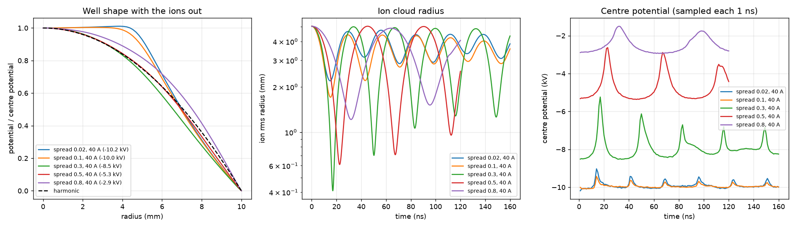
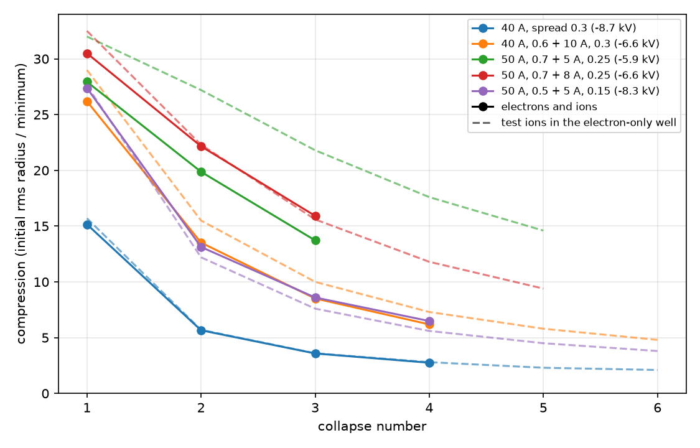

# POPS in WarpX: results so far

All runs: deuterons, 1 cm grounded sphere, WarpX 26.10 electrostatic, 64³ mesh unless noted.
Decks and reductions are in `warpx/pops/`, case lists in `warpx/campaigns/`.
Status: in progress. Sections are added as campaigns finish.

## Stage A: imposed harmonic well, no electrons (CPU)

10 kV well, cloud prepared to compress 10× if ions did not repel each other, two ion periods.

- Breathing period at fill 1e-6: 32.0947473 ns measured, 32.0947473 ns from π/ω with ω = √(2eφ₀/Ma²).
- Compression at the first and fourth collapse, by ion fill (ions per electron of the cloud the well stands for):

| fill | first | fourth | period (ns) |
|---|---|---|---|
| 1e-6 | 8.31 | 8.31 | 32.09 |
| 1e-3 | 8.40 | 9.24 | 32.09 |
| 1e-2 | 7.31 | 4.99 | 33.4 |
| 3e-2 | 4.29 | 3.98 | 34.7 |
| 1e-1 | 1.92 | 1.93 | 36.4 |
| 3e-1 | no collapse | | |

These runs sampled the radius every 10 steps, so the 8.3 at low fill understates the minimum.
With nothing cancelling the ion charge, the collapse stalls near fill × compression ≈ 0.1–0.2.
The same fill 1e-2 case on a B200 gives 7.31 and 5.01.

## Campaign b1: electrons injected from the wall, no ions (one B200 node)

10 keV electrons injected inward over the whole wall, 4 ns. The depth is the uniform-ball estimate
Q/(8πε₀a) from the charge induced on the wall, averaged after 3 ns; it underestimates a centrally
peaked cloud.

| current (A) | tangential spread | electrons | depth estimate (kV) | electron rms radius (mm) |
|---|---|---|---|---|
| 5 | 0.02 | 1.15e10 | 0.85 | 5.61 |
| 10 | 0.02 | 2.79e10 | 2.07 | 5.26 |
| 20 | 0.02 | 5.66e10 | 4.21 | 5.63 |
| 40 | 0.02 | 9.94e10 | 7.37 | 6.40 |
| 20 | 0.1 | 5.15e10 | 3.82 | 5.77 |
| 20 | 0.3 | 3.80e10 | 2.79 | 6.52 |
| 20, 96³ mesh | 0.02 | 5.71e10 | 4.20 | 5.65 |

A uniform ball has an rms radius of 7.7 mm, so the electrons are centrally peaked. The 96³ run
agrees with 64³. Speed: 4000 steps with 1.8e7 macro-electrons took 84 s on one B200.

## Campaign b2: injected electrons and ions together (one B200 node)

40 A unless noted, 160 ns (about five or six collapses). "Shape" is φ(a/2)/φ(0) with the ions
out (0.75 for a harmonic well) and "misfit" is the rms difference from a parabola over radius, in
units of the depth. Both are medians over the 1 ns field samples where the ion cloud is expanded.
"Shallowest centre" is the least negative centre potential among the samples, reached during a
collapse.

| case | compression per collapse | centre (kV) | shape | misfit | shallowest centre (kV) |
|---|---|---|---|---|---|
| fill 1e-3 | 2.45, 2.28, 1.97, 1.66, 1.48, 1.51 | −10.2 | 0.93 | 0.09 | −10.1 |
| fill 1e-2 | 2.30, 1.60, 1.77, 1.73, 1.52, 1.64 | −10.0 | 0.94 | 0.10 | −9.0 |
| fill 3e-2 | 2.17, 1.63, 1.83, 1.79, 1.59, 1.87 | −9.9 | 0.95 | 0.10 | −7.9 |
| fill 1e-1 | 2.22, 1.78, 1.88, 1.96, 1.79, 1.87 | −9.8 | 0.94 | 0.10 | −6.7 |
| fill 1e-2, spread 0.1 | 2.96, 2.29, 1.86, 1.78, 1.71, 1.77 | −10.0 | 0.89 | 0.08 | −9.4 |
| fill 1e-2, spread 0.3 | 12.34, 7.19, 4.75, 3.93, 4.00 | −8.3 | 0.75 | 0.04 | −5.2 |
| fill 1e-2, 20 A | 3.54, 1.72, 1.70, 1.78, 1.73, 1.80, 1.76 | −10.0 | 0.59 | 0.13 | −8.7 |
| fill 1e-2, 4× electron particles | 2.29, 1.59, 1.78, 1.72, 1.51, 1.66 | −10.0 | 0.94 | 0.10 | −8.9 |

- With electrons aimed straight at the centre (spread 0.02) compression is about 1.5–2.5 and does
  not depend on ion fill over a factor of 100. The well is the limit: the centre sits at the full
  electron energy, so the electrons stagnate there and the well is flat-bottomed with a steep edge
  at 40 A and peaked at the centre at 20 A.
- A tangential spread of 0.3 makes the well harmonic and lifts the first collapse to 12×. It then
  fades to 4× by the fourth collapse.
- All ions stay in the sphere. Four times as many electron particles changes nothing.

## Campaign b3: tangential spread against current (one B200 node)

Fill 1e-2, 120 ns. Same columns as b2, plus the fraction of ions still in the sphere at the end.

| spread | current (A) | compression per collapse | centre (kV) | shape | misfit | shallowest centre (kV) | ions kept |
|---|---|---|---|---|---|---|---|
| 0.02 | 5 | 1.83, 1.38, 1.56 | −4.5 | 0.22 | 0.39 | −3.8 | 1.00 |
| 0.02 | 10 | 1.88, 1.38, 1.32 | −10.1 | 0.28 | 0.32 | −10.0 | 1.00 |
| 0.3 | 10 | 4.93, 5.18 | −2.3 | 0.63 | 0.10 | −0.4 | 1.00 |
| 0.5 | 20 | 5.35, 5.51 | −2.7 | 0.73 | 0.02 | −0.8 | 1.00 |
| 0.5 | 40 | 8.26, 7.12, 5.28 | −5.3 | 0.76 | 0.01 | −2.6 | 1.00 |
| 0.8 | 40 | 4.15, 3.33 | −2.9 | 0.81 | 0.05 | −1.5 | 0.96 |
| 0.8 | 80 | 5.40, 2.62, 1.63 | −5.4 | 0.82 | 0.05 | −3.6 | 0.99 |
| 1.2 | 80 | 3.59, 2.26 | −3.1 | 0.85 | 0.09 | −1.9 | 0.99 |

- The spread sets the shape. At 40 A the well goes from flat-bottomed (0.02, 0.1) through harmonic
  (0.3, 0.5: within 1–4% of a parabola) to too shallow in the middle (0.8). A larger spread also
  costs depth: −10, −8.3, −5.3 and −2.9 kV at 40 A for spreads 0.02, 0.3, 0.5 and 0.8.
- In the harmonic wells the limit is the ion charge at the focus. Each collapse lifts the centre
  potential by 2–3 kV (right panel), and at fill 1e-2 that is a third to nearly all of the depth.
  The number of electrons in the sphere does not change during a collapse: electrons with keV
  energies at the centre barely respond to the ion charge.
- Mesh caveat: at 12× the ion cloud's rms radius is 0.42 mm and a cell is 0.35 mm, so the deepest
  collapses are not resolved on 64³.

## Campaign b4: ion fill in the harmonic well, mesh, and a centre-aimed beam (one B200 node)

40 A, spread 0.3 (the harmonic well of b2), 120 ns. "Ideal well" is a CPU control with the same ions
in an imposed 8.277 kV parabola and no electrons.

| case | compression per collapse | ideal well, first → last collapse |
|---|---|---|
| fill 1e-3 | 15.16, 5.66, 3.58, 2.75 | 35.2 → 9.8 (8 collapses) |
| fill 1e-2 (b2) | 12.34, 7.19, 4.75, 3.93, 4.00 | 12.2 → 2.1 (12 collapses) |
| fill 1e-2 on 128³ (60 ns) | 10.69, 10.02 | |
| fill 3e-2 | 5.89, 5.75, 5.06 | 4.43 → 3.78 (7 collapses) |
| fill 1e-1 | 2.53, 2.57, 2.52 | 1.72 → 1.73 (7 collapses) |
| fill 1e-2, steady 3 A beam at the centre | 10.57, 4.24, 3.01, 2.54 | |
| fill 1e-2, 5 A pulses at each collapse | 13.52, 5.75, 3.34 | |
| fill 1e-2, 15 A pulses | 13.96, 5.68, 3.54, 3.19 | |
| fill 1e-2, 40 A pulses | 14.15, 5.66, 3.66 | |

- The ion charge sets the first collapse: fill × compression is 0.12, 0.18 and 0.25 at fills 1e-2,
  3e-2 and 1e-1. Real electrons give 1.3–1.5 times the ideal-well compression at the two highest
  fills, so they cancel little of the ion charge.
- The fade over successive collapses is strongest at the lowest fill, so it is not the ion charge.
  It is the well shape (next section).
- A 10 keV beam pulsed onto the centre at each collapse adds 10–15% to the first collapse whatever
  its current, and does nothing for the fade. A steady one deepens the centre to −10 kV and makes
  the well less harmonic.
- Mesh: at fill 1e-2 the first collapse is 10.7 on 128³ against 12.3 on 64³, and the second is 10.0
  against 7.2. Numbers at this fill carry that uncertainty.

## Well-shape search (campaigns b5, b7, b8, b10: 168 electron-only runs, 70–180 s each)

`warpx/pops/analyze_well_scan.py` fits the time-averaged well of an electron-only run and follows
6000 chargeless test ions in it. That predicts the compression at each collapse in seconds.

- **The prediction matches the full simulation at low fill.** For the 40 A, spread 0.3 well it
  gives 14.9, 5.4, 3.4, 2.6; the fill 1e-3 run gave 15.16, 5.66, 3.58, 2.75. So the fade is ions of
  different amplitude drifting out of step in a slightly non-harmonic well: there the bounce period
  varies by 4.3% (rms) across the cloud.
- **The well shape does not depend on the numerics.** For the best b7 well the predicted five
  collapses are 32.0, 27.2, 21.8, 17.6, 14.6 on 64³; 31.8, 26.0, 20.1, 15.9, 13.0 on 96³ and 128³;
  32.0, 27.5, 22.2, 18.0, 15.0 with four times the particles; 31.9, 27.8, 22.9, 18.9, 15.8 at half
  the time step.
- **Two electron populations make a much more harmonic well than one.** A broad main beam leaves
  the centre slightly too flat; a few amps with a narrower spread fill it in.

| electrons (current, spread) | centre (kV) | period variation (rms) | predicted compression, collapses 1–5 |
|---|---|---|---|
| 40 A, 0.3 (b2/b4 well) | −8.7 | 4.3% | 15.5, 5.6, 3.6, 2.7, 2.3 |
| 40 A, 0.45 | −6.2 | 2.0% | 25.1, 11.7, 7.3, 5.4, 4.3 |
| 20 A, 0.6 | −2.4 | 0.9% | 20.4, 16.3, 12.4, 9.7, 7.9 |
| 40 A, 0.6 + 10 A, 0.3 | −6.7 | 1.6% | 28.9, 15.4, 9.9, 7.3, 5.7 |
| 50 A, 0.7 + 5 A, 0.25 | −5.9 | 0.65% | 32.0, 27.2, 21.8, 17.6, 14.6 |
| 60 A, 0.9 + 5 A, 0.25 | −5.3 | 0.31% | 30.1, 26.5, 22.0, 18.2, 15.2 |
| 60 A, 0.8 + 8 A, 0.25 | −6.6 | 0.66% | 34.0, 30.6, 26.0, 21.9, 18.6 |
| 70 A, 0.9 + 8 A, 0.25 | −6.5 | 0.60% | 33.6, 30.5, 26.3, 22.3, 19.0 |

- Wells deeper than about 70% of the electron energy are not harmonic in any run: at 80 A with a
  single beam the centre saturates at the full 10 kV and flattens.

## Ions in the searched wells (campaigns b6, b9: electrons and ions together, fill 1e-3, 64³)

| electrons (current, spread) | centre (kV) | compression per collapse | test-ion prediction |
|---|---|---|---|
| 40 A, 0.3 (b4) | −8.7 | 15.2, 5.7, 3.6, 2.8 | 14.9, 5.4, 3.4, 2.6 |
| 20 A, 0.5 | −3.0 | 18.2, 11.6, 8.6, 7.0 | 18.8, 9.2, 5.9, 4.4 |
| 20 A, 0.6 | −2.4 | 16.3, 10.9, 7.2, 5.3 | 20.4, 16.3, 12.5, 9.8 |
| 40 A, 0.45 | −6.2 | 23.0, 10.7, 6.7, 4.9 | 25.1, 11.7, 7.3, 5.4 |
| 20 A, 0.4 + 20 A, 0.5 | −6.3 | 23.2, 10.9, 6.9, 5.1 | 25.0, 11.5, 7.2, 5.3 |
| 40 A, 0.5 + 10 A, 0.2 | −8.3 | 21.2, 8.7, 5.5, 4.2 | 21.4, 8.3, 5.2, 3.9 |
| 40 A, 0.6 + 10 A, 0.3 | −6.6 | 26.2, 13.5, 8.5, 6.2 | 29.0, 15.5, 10.0, 7.3 |
| same, 128³ (70 ns) | −6.7 | 24.7, 12.4 | |
| 50 A, 0.5 + 5 A, 0.15 | −8.3 | 27.4, 13.1, 8.6, 6.5, 5.3 | 27.6, 12.2, 7.6, 5.6, 4.5 |
| 40 A, 0.6 + 5 A, 0.25 | −5.9 | 27.6, 18.1, 12.9, 10.0, 8.2 | 28.8, 16.7, 11.0, 8.2, 6.5 |
| 50 A, 0.7 + 5 A, 0.25 | −5.9 | 27.9, 19.9, 13.7, 10.0, 7.7 | 32.0, 27.2, 21.8, 17.6, 14.6 |
| 50 A, 0.7 + 8 A, 0.25 | −6.6 | 30.5, 22.2, 15.9, 12.0, 9.5 | 32.5, 22.3, 15.6, 11.8, 9.4 |

- Shaping the well with two electron populations doubles the first collapse (15 → 30) and raises
  the fifth from about 2.5 to 9.5.
- The test-ion prediction ranks the wells correctly and is within about 10% for most. It is too
  optimistic for the 20 A, 0.6 well (−2.4 kV) and for the most harmonic one (50 A, 0.7 + 5 A,
  0.25); the cause is not established.
- Mesh: 128³ gives 24.7, 12.4 where 64³ gives 26.2, 13.5.
- With more ions in the 50 A, 0.7 + 5 A, 0.25 well: fill 3e-3 gives 21.3, 11.1, 6.6, 5.0, 4.3;
  fill 1e-2 gives 9.1, 7.9, 6.0, then the oscillation turns irregular and 10% of the ions reach
  the wall by 220 ns.

## A low-energy electron beam as a neutraliser (campaign b11): no effect below the well depth

Well: 60 A, 0.8 + 8 A, 0.25 (−6.6 kV). A third, steady beam of 4–6 keV electrons is turned back
short of the centre by the well, and should reach the centre only when the ion charge lifts it.

| fill | extra beam | compression per collapse | ions kept |
|---|---|---|---|
| 3e-2 | none | 4.07, 4.18, 4.16 | 1.00 |
| 3e-2 | 1 A, 5 keV | 3.99, 4.07, 4.06 | 1.00 |
| 3e-2 | 1 A, 6 keV | 6.94, 5.97, 4.07 | 0.97 |
| 3e-2 | 3 A, 4 keV | 3.91, 3.89, 3.74 | 0.96 |
| 3e-2 | 3 A, 5 keV | 3.80, 3.72, 3.42 | 0.95 |
| 3e-2 | 3 A, 6 keV | 3.81, 3.61, 3.77 | 0.99 |
| 1e-1 | none | 1.69, 1.71, 1.71 | 1.00 |
| 1e-1 | 3 A, 4 keV | 1.69, 1.67, 1.67 | 0.99 |

- Beams at 4 and 5 keV, and 3 A at 6 keV, change nothing. They are turned back before the centre.
- 1 A at 6 keV is the exception: 6.94 on the first collapse. Its electron count in the sphere rises
  from 1.15 to 1.67 per ion during the collapse. An earlier version of this section said the count
  did not rise; that was wrong. The surrounding potential minimum there is −6.06 to −6.14 kV, so a
  6 keV beam just reaches the core. At 3 A the well deepens to −6.75 kV and the beam is shut out.
- Campaigns b17 and b19 below scan this energy window.
- Fill × compression stays at 0.12–0.17 in this well without the beam, against 0.18–0.25 in the
  deeper 40 A, spread 0.3 well. A more harmonic well does not help once the ion charge is the limit.
- The 10 keV pulses and the steady 10 keV beam of campaign b4 pass through the core at speed and do
  not cancel the ion charge.

## The best wells over eight collapses (campaign b12, 64³, 300 ns)

Well: 60 A, spread 0.8 + 8 A, spread 0.25 (−6.6 kV) unless noted. Cloud released at rest with rms
radius 0.3a and 1 eV.

| case | compression per collapse | ions kept |
|---|---|---|
| fill 1e-4 | 33.0, 29.8, 25.5, 21.5, 18.3, 15.8, 13.8, 12.2 | 1.00 |
| test-ion prediction | 34.0, 30.6, 26.0, 21.9, 18.6 | |
| fill 1e-3 | 30.7, 24.9, 18.7, 14.1, 11.0, 9.2, 8.1, 7.3 | 1.00 |
| fill 3e-3 | 24.3, 14.0, 8.4, 6.4, 5.5, 5.1, 4.8, 4.5 | 1.00 |
| fill 1e-3, ions at 10 eV | 10.2, 10.1, 9.8, 9.4, 8.9, 8.4, 7.9, 7.4 | 1.00 |
| fill 1e-3, 8× the ion particles (150 ns) | 30.7, 24.9, 18.8, 14.2 | 1.00 |
| fill 1e-3, 128³ (70 ns) | 28.8, 21.6 | 1.00 |
| fill 1e-3, 70 A, 0.9 + 8 A, 0.25 (−6.5 kV) | 30.0, 23.5, 17.3, 13.0, 10.1, 8.4, 7.3 | 1.00 |
| fill 1e-3, 60 A, 0.9 + 5 A, 0.25 (−5.2 kV) | 26.7, 21.3, 15.9, 12.0, 9.4, 7.7, 6.4 | 1.00 |

- With the ion charge negligible (fill 1e-4) the full run follows the test-ion prediction to 3%.
  At fill 1e-3 the later collapses are already weaker, so the ion charge adds to the dephasing
  well before it stops the first collapse.
- The ion temperature caps the first collapse: 33 at 1 eV, 10.2 at 10 eV, a ratio of √10. At
  10 eV the compression barely fades, 10.2 to 7.4 over eight collapses.
- Eight times the ion particles changes nothing. 128³ lowers the first two collapses by 6% and
  13%. 128³ for 50 A, 0.7 + 5 A, 0.25 (b9) gives 26.1, 17.6 against 27.9, 19.9.
- 60 A, 0.9 + 5 A, 0.25 has the smallest bounce-period spread of the search (0.3%) and still
  compresses less than the deeper wells: a well under about 6 kV loses more to the ion charge
  than it gains in shape.

## Radio-frequency drive (campaign b13, 64³, 400 ns)

Well: 60 A, 0.8 + 8 A, 0.25. The ion cloud starts warm and in balance with the well (rms radius
0.12a per axis, 191.5 eV), so without a drive it does not oscillate. All three electron currents
are then modulated by a fraction h at the cloud's breathing period, 39.31 ns. The table gives the
largest over the smallest rms radius within each drive period (`analyze_rf_drive.py`).

| h | fill | swing in drive periods 1 to 10 | smallest radius / initial | ions kept |
|---|---|---|---|---|
| 0 | 1e-3 | 1.04 throughout | 1.00 | 1.00 |
| 0.1 | 1e-4 | 1.05, 1.11, 1.18, 1.26, 1.34, 1.42, 1.52, 1.61, 1.72, 1.83 | 0.75 | 1.00 |
| 0.1 | 1e-3 | 1.03, 1.08, 1.15, 1.23, 1.31, 1.39, 1.48, 1.58, 1.68, 1.79 | 0.77 | 1.00 |
| 0.1 | 3e-3 | 1.09, 1.04, 1.10, 1.18, 1.26, 1.34, 1.43, 1.52, 1.61, 1.71 | 0.81 | 1.00 |
| 0.1 | 1e-2 | 1.32, 1.20, 1.13, 1.17, 1.26, 1.36, 1.45, 1.53, 1.63, 1.73 | 0.88 | 1.00 |
| 0.1 | 1e-2, drive 5% slower | 1.32, 1.20, 1.09, 1.03, 1.11, 1.22, 1.33, 1.45, 1.58, 1.71 | 0.88 | 1.00 |
| 0.2 | 1e-3 | 1.07, 1.20, 1.37, 1.56, 1.77, 2.02, 2.30, 2.61, 2.95, 3.31 | 0.58 | 0.985 |
| 0.1 | 1e-3, 96³ (4 periods) | 1.03, 1.07, 1.14, 1.21 | | 1.00 |

- The drive pumps the oscillation: the swing grows by about 6% per period at h = 0.1 and 13% at
  h = 0.2, with no sign of levelling off in ten periods, and the same on 96³.
- The well follows the current: the centre potential is modulated by 0.78h and the difference
  between the centre and half radius by 0.53h, in phase with the current.
- Test ions in a well whose depth is modulated by 10.6% grow 18% per period, so the full run
  pumps at about three quarters of that rate. In that calculation the growth only ends when the
  ions reach the wall (8% left after 30 periods). The drive is a pump, not a steady state.
- Estimate, not measured: the drive should not beat the temperature limit. In a harmonic well a
  breathing cloud keeps the product of its largest and smallest radius, so a cloud that starts at
  0.12a and stops short of the wall (0.45a) gets no smaller than about 0.03a. The 1 eV cloud
  released from 0.3a reaches 0.01a.
- At fill 1e-2 the starting cloud is not in balance (its own charge pushes it out), which is the
  early transient; after it the growth rate is the same as at low fill.

### Stronger drive (campaign b14, 64³, 400 ns)

Same well and starting cloud, h = 0.4 unless noted. Columns are drive periods 2, 4, 6, 8 and 10.

| fill | swing | smallest radius / initial | ions kept |
|---|---|---|---|
| 1e-4 | 1.50, 2.51, 3.97, 5.43, 6.51 | 0.86, 0.66, 0.52, 0.44, 0.39 | 1.00, 1.00, 0.96, 0.85, 0.68 |
| 1e-3 | 1.47, 2.50, 3.92, 5.22, 6.01 | 0.88, 0.68, 0.53, 0.45, 0.41 | 1.00, 1.00, 0.96, 0.84, 0.67 |
| 1e-3, h = 0.7 | 1.98, 4.05, 4.91, 4.69, 4.13 | 0.80, 0.54, 0.50, 0.51, 0.54 | 1.00, 0.93, 0.67, 0.45, 0.32 |
| 1e-2 | 1.34, 2.54, 4.02, 4.94, 5.12 | 1.06, 0.74, 0.57, 0.49, 0.46 | 1.00, 1.00, 0.94, 0.77, 0.63 |
| 3e-2 | 1.40, 3.10, 5.41, 8.55, 10.04 | 1.25, 0.80, 0.53, 0.36, 0.30 | 1.00, 1.00, 0.85, 0.60, 0.37 |
| 3e-2, drive 8% slower (periods 2 to 9) | 1.28, 3.15, 7.17, 14.68, 19.83 (period 9) | 1.29, 0.83, 0.46, 0.23, 0.17 (period 9) | 1.00, 0.99, 0.70, 0.30, 0.19 (period 9) |
| 1e-1 | 1.88, 4.37, 9.89, 14.83, 11.32 | 1.42, 0.82, 0.37, 0.24, 0.26 | 1.00, 0.72, 0.32, 0.14, 0.07 |

- The swing grows about 30% per period at h = 0.4 until ions reach the wall, from the fifth period
  on. After that the cloud loses a third or more of its ions in five periods. The 96³ run agrees
  over its four periods (1.13, 1.44, 1.86, 2.39 against 1.14, 1.47, 1.92, 2.50).
- The smallest radius never falls below 0.39 of the starting radius while most ions are kept. The
  smaller values at fill 3e-2 and 1e-1 come after most of the ions are gone, so they describe a
  cloud with a lower fill, not a better collapse.
- The drive pumps the oscillation until ions are lost. None of these runs reaches a steady
  oscillation.

## Slow electrons released at the centre (campaigns b15, b16, b18): a numerical control

These runs release 5 eV electrons from a 1 mm disc at the centre of the sphere. No gun does this.
The runs show how much compression the ion charge is costing, and nothing about how a device
would supply the electrons. Well: 60 A, 0.8 + 8 A, 0.25. Mesh 64³ unless noted.

| fill | electrons released | compression per collapse | ions kept |
|---|---|---|---|
| 1e-2 | none | 10.43, 8.85, 6.56 | 0.94 |
| 1e-2 | steady, 1 per ion per collapse time | 20.69, 10.96, 7.85 | 1.00 |
| 1e-2 | steady, 3 per ion | 12.71, 6.57 | 1.00 |
| 3e-2 | none | 4.07, 4.18, 4.16 | 1.00 |
| 3e-2 | one pulse, 0.3 per ion | 5.01, 2.96, 2.47 | 1.00 |
| 3e-2 | one pulse, 1 per ion | 7.30, 2.19, 2.08 | 1.00 |
| 3e-2 | one pulse, 3 per ion | 8.08, 2.39, 2.12 | 1.00 |
| 3e-2 | steady, 0.3 per ion | 6.09, 2.26, 2.42 | 1.00 |
| 3e-2 | steady, 1 per ion | 10.80, 3.36, 1.73 | 1.00 |
| 3e-2 | steady, 1 per ion, 2 mm disc | 10.46, 2.94, 1.87 | 1.00 |
| 3e-2 | steady, 3 per ion | 10.67, 4.92 | 1.00 |
| 3e-2 | steady, 1 per ion, 50 eV | 9.04, 2.49 | 1.00 |
| 1e-1 | none | 1.69, 1.71, 1.71 | 1.00 |
| 1e-1 | one pulse, 1 per ion | 1.90, 1.43, 1.53 | 1.00 |
| 1e-1 | steady, 1 per ion | 2.94, 1.86, 1.75 | 1.00 |

Mesh and particle-count checks of the steady, 1 per ion runs (first collapse):

| fill | 64³ | 96³ | 128³ | 64³, 8× the released particles |
|---|---|---|---|---|
| 1e-2 | 20.69 | 19.62 | 19.24 | |
| 3e-2 | 10.80 | 10.19 | 9.98 | 10.80 |

- Slow electrons at the centre roughly double the first collapse at fill 1e-2 and 3e-2. The
  potential bump the ions raise at the centre falls from about 2.0 kV to about 50 V at fill 1e-2,
  and from about 2.4 kV to about 260 V at fill 3e-2.
- The gain holds on finer meshes to within 8%, and does not depend on the number of released
  particles. The released electrons' Debye length is below one cell, so their own structure is
  not resolved; the first-collapse number is nonetheless stable.
- It works once. From the second collapse on, the runs with released electrons do worse than the
  runs without. The electrons leave as the cloud re-expands, and the ion cloud comes back out of
  step.
- Releasing three times as many does not help, and at fill 1e-2 it hurts (12.71 against 20.69).

## A wall beam just above the well depth (campaigns b17, b19, 64³, fill 3e-2)

A third electron population is injected from the wall, like the other two, at an energy close to
the well depth. This is an external source, unlike the released electrons above. Well: 60 A,
0.8 + 8 A, 0.25, which is −6.6 kV deep without the beam. Baseline: 4.07, 4.18, 4.16.

| beam | compression per collapse | ions kept |
|---|---|---|
| 0.3 A, 6.0 keV | 5.08, 4.94, 4.75 | 1.00 |
| 0.3 A, 6.2 keV | 4.95, 4.68, 4.37 | 1.00 |
| 0.5 A, 6.6 keV | 5.16, 4.26, 3.94 | 1.00 |
| 1 A, 6.1 keV | 7.70, 6.65, 4.80 | 0.98 |
| 1 A, 6.2 keV | 8.61, 7.27, 5.82 | 0.99 |
| 1 A, 6.3 keV | 9.65, 7.68, 6.58 | 1.00 |
| 1 A, 6.4 keV | 10.79, 7.87, 6.82 | 1.00 |
| 1 A, 6.6 keV | 12.74, 7.73, 6.50 | 1.00 |
| 1 A, 6.8 keV | 11.99, 6.59, 4.93 | 1.00 |
| 1 A, 7.0 keV | 5.84, 6.33, 3.84 | 1.00 |
| 1 A, 7.3 keV | 4.84, 3.81, 3.22, 3.17 | 1.00 |
| 1 A, 7.7 keV | 4.43, 3.25, 2.80 | 1.00 |
| 1 A, 8.2 keV | 4.69, 3.61, 3.13 | 1.00 |
| 2 A, 6.4 keV | 5.90, 5.44, 4.38 | 1.00 |
| 2 A, 7.0 keV | 9.26, 7.95, 7.81, 7.68 | 1.00 |
| 2 A, 7.4 keV | 10.54, 5.61, 4.54, 4.79 | 1.00 |

- At 1 A the first collapse rises from 7.7 at 6.1 keV to 12.7 at 6.6 keV, holds at 6.8 keV, and
  falls to 5.8 at 7.0 keV. The useful window is about 0.5 keV wide and its upper edge is sharp.
- The beam is turned back just short of the centre and its slow electrons pile up there. That
  pulls the centre to 130–200 V below the beam energy at every energy from 6.6 to 7.4 keV
  (−6.81 kV at 6.6 keV, −7.13 kV at 7.0 keV; −6.6 kV with no beam).
- In the 6.6 keV run the beam's electron count in the sphere rises from 1.23 to 1.97 per ion as
  the ions fall in. From about 15 ns the lowest potential is no longer at the centre but 2.2 mm
  out, at −6.68 kV, below the beam energy. The beam turns back there, and inside that radius the
  ion bump still grows: the centre rises to −3.5 kV at the collapse.
- At 7.0 keV and 1 A the pile-up does not survive the ions' arrival. Between 12 and 14 ns the
  beam's count drops from 1.38 to 1.19 per ion and then to 0.95, the lowest potential in the
  sphere rises to −5.5 kV, and the beam passes straight through. The collapse then reaches 5.8,
  close to the run with no beam. 7.3 keV does the same from 10 ns.
- 2 A holds the pile-up at 7.0 and 7.4 keV (3.0 electrons per ion at the collapse) and gives 9.3
  and 10.5. At 6.4 keV the same 2 A gives 5.9.
- The best energy for 2 A has not been found.
- The gain lasts beyond the first collapse, unlike the released electrons: 7.7 and 6.5 on the
  second and third collapses against 4.2 without the beam.
- 2 A at 7.0 keV has the lower first collapse but holds it: 9.3, 8.0, 7.8, 7.7 over four
  collapses. 2 A at 7.4 keV fades to 4.8 by the fourth.
- A beam above the window is worse than no beam after the first collapse (1 A at 7.3–8.2 keV:
  about 3.2 on the third against 4.2).
- At 12.7× the cloud's rms radius per axis is about one 64³ cell. The next section has the mesh
  check and the other ion fills.

## The wall beam at other ion fills, on a finer mesh, and with a spread (campaigns b20–b25)

Same well and 64³ mesh unless stated. Campaigns b20–b25 were still running when these were read:
most rows have one to three collapses.

| fill | beam | compression per collapse | fill × first compression |
|---|---|---|---|
| 1e-2 | none | 10.43, 8.85, 6.56 | 0.10 |
| 1e-2 | 0.3 A, 6.7 keV | 15.20, 10.30 | 0.15 |
| 1e-2 | 0.5 A, 6.8 keV | 18.74, 8.02 | 0.19 |
| 1e-2 | 0.5 A, 6.8 keV, 96³ | 18.21 | 0.18 |
| 1e-2 | 1 A, 6.6 keV | 12.58, 10.33 | 0.13 |
| 1e-2 | 1 A, 6.8 keV | 14.98, 10.75 | 0.15 |
| 1e-2 | 1 A, 7.0 keV | 16.06, 8.34, 6.45 | 0.16 |
| 1e-2 | 1 A, 7.2 keV | 14.25, 5.94, 4.34 | 0.14 |
| 1e-2 | 1 A, 7.4 keV | 11.08, 4.35, 3.13 | 0.11 |
| 3e-2 | none | 4.07, 4.18, 4.16 | 0.12 |
| 3e-2 | 1 A, 6.6 keV, 96³ | 11.55 | 0.35 |
| 3e-2 | 1 A, 6.6 keV, 128³ | 11.12 | 0.33 |
| 3e-2 | 1 A, 6.7 keV | 12.88, 7.26, 5.69 | 0.39 |
| 3e-2 | 1.5 A, 6.9 keV | 11.32, 6.78 | 0.34 |
| 3e-2 | 2 A, 7.8 keV | 7.86, 3.81 | 0.24 |
| 3e-2 | 1 A, 6.6 keV, 2% spread | 9.65, 7.54 | 0.29 |
| 3e-2 | 1 A, 6.6 keV, 5% spread | 7.22, 5.77 | 0.22 |
| 1e-1 | none | 1.69, 1.71, 1.71 | 0.17 |
| 1e-1 | 1 A, 4.6 keV | 2.27, 2.26, 2.32 | 0.23 |
| 1e-1 | 1 A, 4.9 keV | 2.27, 2.23 | 0.23 |
| 1e-1 | 3 A, 4.8 keV | 2.08, 1.66 | 0.21 |
| 1e-1 | 3 A, 5.2 keV | 2.43, 1.75 | 0.24 |
| 1e-1 | 3 A, 5.6 keV | 3.04, 2.14 | 0.30 |
| 1e-1 | 3 A, 6.0 keV | 4.16, 3.64 | 0.42 |
| 1e-1 | 3 A, 6.4 keV | 6.17, 4.83 | 0.62 |
| 1e-1 | 3 A, 6.8 keV | 7.53 | 0.75 |
| 1e-1 | 3 A, 7.2 keV | 5.40 | 0.54 |
| 1e-1 | 3 A, 7.6 keV | 2.33, 2.90 | 0.23 |
| 1e-1 | 3 A, 8.2 keV | 2.17, 1.86 | 0.22 |
| 1e-1 | 6 A, 5.6 keV | 2.03, 1.60 | 0.20 |
| 1e-1 | 6 A, 7.2 keV | 4.00, 3.40 | 0.40 |
| 3e-1 | none | no collapse | – |
| 3e-1 | 3 A, 6.4 keV | no collapse | – |
| 3e-1 | 6 A, 4.0 keV | 1.52 | 0.46 |
| 3e-1 | 6 A, 5.0 keV | 2.99 | 0.90 |
| 3e-1 | 6 A, 7.2 keV | no collapse | – |
| 3e-1 | 10 A, 4.0 keV | 1.30 | 0.39 |
| 3e-1 | 10 A, 5.0 keV | 1.57 | 0.47 |
| 3e-1 | 10 A, 6.0 keV | 2.44 | 0.73 |
| 3e-1 | 20 A, 5.0 keV | no collapse | – |
| 3e-1 | 20 A, 6.0 keV | 1.40 | 0.42 |
| 3e-1 | 20 A, 7.0 keV | 1.66 | 0.50 |

"Spread" here is the beam's sideways momentum spread over its inward momentum; the other beam rows
use 0.5%.

- Mesh: the fill 3e-2, 1 A, 6.6 keV first collapse is 12.74 at 64³, 11.55 at 96³ and 11.12 at
  128³. The fill 1e-2, 0.5 A, 6.8 keV first collapse is 18.74 at 64³ and 18.21 at 96³.
- Fill 1e-2: the best first collapse is 18.7 at 0.5 A and 6.8 keV, against 10.4 without the beam
  and 20.7 with electrons released at the centre. 1 A is past the best current at this fill.
- Fill 1e-2, later collapses: 1 A at 6.6 and 6.8 keV and 0.3 A at 6.7 keV give 10.3–10.8 on the
  second collapse, against 8.9 without the beam. The settings with the highest first collapse
  do not: 0.5 A at 6.8 keV gives 8.0, and 1 A at 7.0–7.4 keV gives 8.3, 5.9 and 4.4.
- Fill 1e-1: with 3 A the first collapse rises from 2.1 at 4.8 keV to 7.5 at 6.8 keV, then
  falls to 5.4 at 7.2 keV and 2.3 at 7.6 keV. Without the beam it is 1.7. 6 A does worse than
  3 A at both energies tried.
- At fill 1e-1 the beam's electron count in the sphere is steady from 15 ns on, at 1.7 per ion
  in the 6.4 keV run, and does not rise during the collapse. The 3 A beam holds 28% as many
  electrons as the 68 A of 10 keV electrons, and the centre sits at the beam energy (−6.45 kV at
  6.4 keV). So here the beam acts as a steady store of slow electrons at the centre, not as a
  supply that responds to the ions as at fill 3e-2.
- Fill 3e-1: without the beam the cloud does not collapse and the centre is only −1.4 to
  −2.1 kV. 6 A at 5.0 keV gives 3.0 and 10 A at 6.0 keV gives 2.4. More current needs more
  energy, as at the lower fills, and 20 A does worse than 6 or 10 A at every energy tried.
- The largest fill × compression is 0.90 (fill 3e-1, 6 A, 5.0 keV) and the next is 0.75 (fill
  1e-1, 3 A, 6.8 keV), against 0.10–0.17 with no beam. Both are first collapses on the 64³ mesh
  with no finer-mesh check, from scans in steps of 0.4–1 keV.
- Best fill × first compression found at each fill, with the beam: 0.19, 0.39, 0.75, 0.90 at
  fills 1e-2, 3e-2, 1e-1, 3e-1. It rises with fill but more slowly than the fill does.
- A beam with more sideways spread does worse: 9.7 at 2% and 7.2 at 5%, against 12.7 at 0.5%.
- The settings come from coarse scans. None of the four fills has a located optimum in both
  current and energy.

### Released electrons at four birth temperatures (campaign b21, fill 1e-2, numerical control)

| birth temperature | first collapse |
|---|---|
| 0.5 eV | 20.29 |
| 5 eV | 20.69 |
| 50 eV | 19.80 |
| 500 eV | 13.27 |

At the collapse the released electrons number about 1.2 per ion, have a temperature of 110–140 eV
and an rms radius of 1.4–1.7 mm, for every birth temperature up to 50 eV. The ions' rms radius is
0.25 mm. So the electrons that cancel the ion charge are far hotter and more spread out than they
were born, and the birth temperature below 50 eV does not matter. It is not heating by
the mesh or the time step (campaign b23, 5 eV birth):

| run | first collapse | electron temperature at the collapse | electron rms radius |
|---|---|---|---|
| 64³ | 20.69 | 110 eV | 1.49 mm |
| 64³, half time step | 20.66 | 112 eV | 1.51 mm |
| 96³ | 19.62 | 152 eV | 1.70 mm |
| 128³ | (19.24 in b18) | 138 eV | 1.63 mm |

The released electrons already have about 700 eV and an rms radius of 3.9 mm at 1–10 ns, long
before the collapse. The centre of the well is the top of a potential hill for electrons, so
most roll out and leave; about 0.2 per ion stay in the sphere. Only when the ions arrive is
there a trough at the centre to hold them, and the electrons it holds have the energy of that
trough, not their birth energy.
